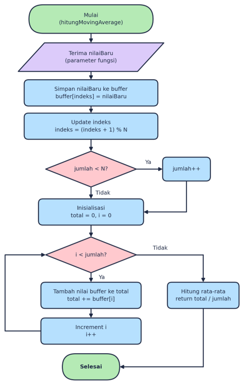
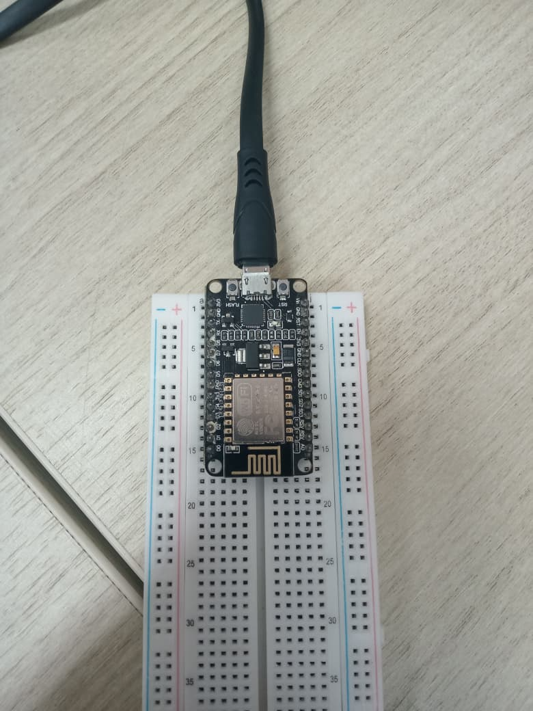
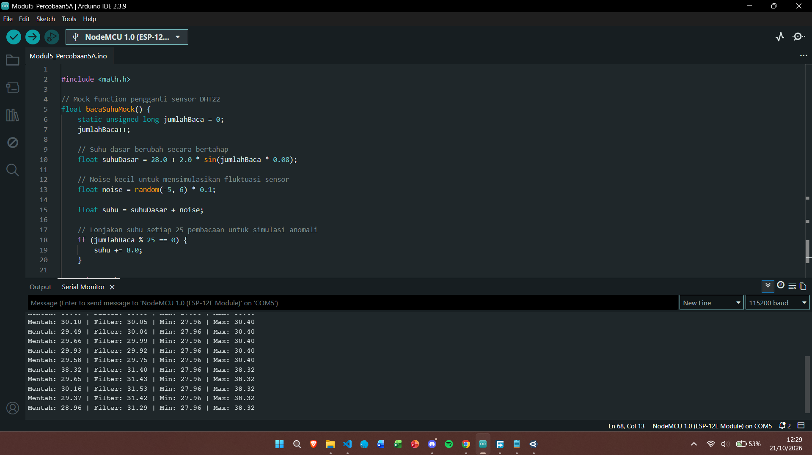
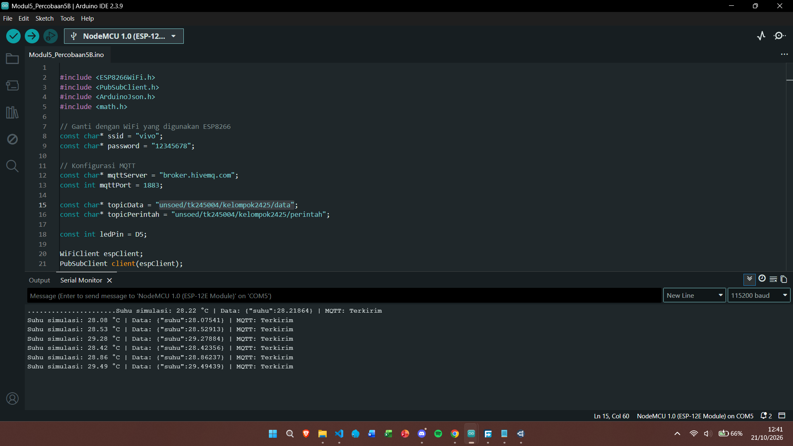
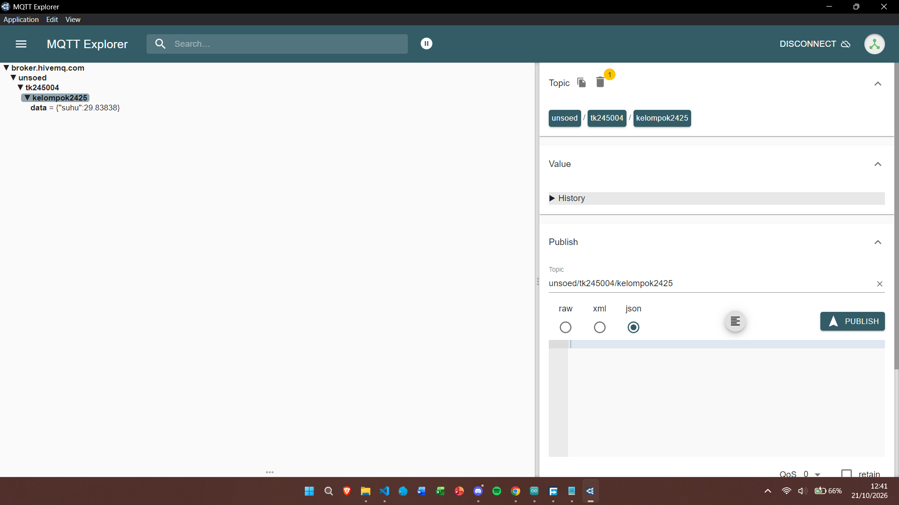
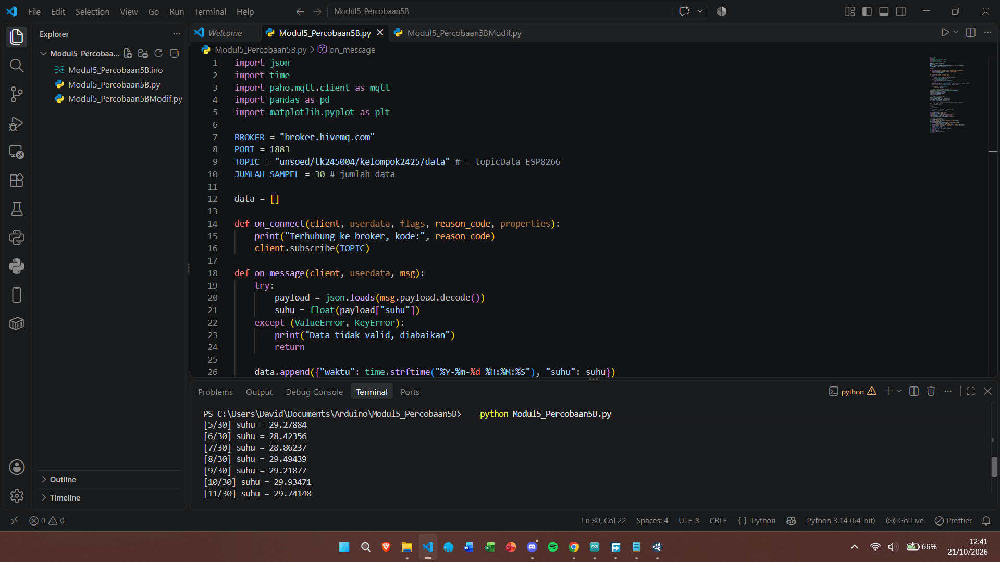

# Pertemuan 5 - Pengolahan dan Analisis Data

## Penjelasan Code

### Percobaan 5A - Moving Average dan Statistik pada Perangkat

Program Percobaan 5A dapat dilihat di [code/Percobaan5A.ino](code/Percobaan5A.ino). Program menghasilkan data suhu simulasi yang berfluktuasi, menambahkan noise kecil, dan membuat lonjakan suhu setiap 25 pembacaan. Data tersebut dipakai untuk menguji pengolahan di sisi perangkat tanpa bergantung pada sensor.

Setiap dua detik, program memasukkan suhu baru ke dalam buffer berukuran lima. Fungsi `hitungMovingAverage()` menghitung rata-rata sampel yang tersedia di awal program, kemudian rata-rata lima sampel terakhir setelah buffer penuh. Program juga menyimpan suhu minimum dan maksimum sejak board dinyalakan dan menampilkan nilai mentah, hasil filter, minimum, serta maksimum pada Serial Monitor.

### Percobaan 5B - Akuisisi, Analisis, dan Visualisasi

Program pengirim MQTT tersedia di [code/Percobaan5B.ino](code/Percobaan5B.ino). Sketch ini menggunakan ESP8266, menghasilkan suhu simulasi setiap tiga detik, dan mempublikasikannya sebagai JSON pada topic `unsoed/tk245004/kelompok2425/data`. Sketch juga menerima perintah `ON` atau `OFF` pada topic perintah untuk mengendalikan LED.

Program analisis Python tersedia di [code/Percobaan5B.py](code/Percobaan5B.py). Python mengumpulkan 30 sampel dari topic data, menyimpan waktu dan suhu ke `data_suhu.csv`, menghitung statistik deskriptif, dan mendeteksi anomali menggunakan z-score. Program kemudian menerapkan moving average dengan jendela lima data, menghitung ulang z-score pada hasil filter, membandingkan jumlah anomali sebelum dan sesudah filter, serta menyimpan grafik sebagai `grafik_suhu.png`.

> **Catatan kesesuaian perangkat:** Modul praktikum mengarahkan penggunaan ESP32 dan sensor DHT22 pada GPIO 4. Berkas Percobaan 5A dan sketch Percobaan 5B yang disertakan di sini memakai suhu simulasi; sketch MQTT juga menggunakan library dan board ESP8266. Jadi, kode ini mendemonstrasikan algoritma dan alur MQTT, tetapi bukan pembacaan langsung DHT22/ESP32. Untuk praktikum dengan perangkat fisik, ganti `bacaSuhuMock()` dengan pembacaan `dht.readTemperature()`, gunakan library DHT, dan sesuaikan library WiFi serta konfigurasi pin dengan board yang dipakai.

## Penjelasan Setiap Fungsi

- `setup()` pada Percobaan 5A memulai Serial Monitor dan menginisialisasi seed untuk bilangan acak.
- `bacaSuhuMock()` menghasilkan suhu dasar yang berubah perlahan, menambahkan noise, dan menyisipkan lonjakan untuk simulasi anomali.
- `hitungMovingAverage(nilaiBaru)` menyimpan nilai baru ke buffer melingkar, memperbarui jumlah sampel yang tersedia, lalu mengembalikan nilai rata-ratanya.
- `loop()` pada Percobaan 5A membaca suhu simulasi, mengabaikan nilai tidak valid, memperbarui hasil filter dan statistik minimum/maksimum, lalu menampilkan hasil setiap dua detik.
- `setup()` pada sketch Percobaan 5B mengatur Serial Monitor dan LED, menghubungkan WiFi, serta menyiapkan server dan callback MQTT.
- `callback()` mengubah payload MQTT menjadi teks, membaca JSON, lalu menyalakan atau mematikan LED sesuai nilai `perintah`.
- `hubungkanWiFi()` menghubungkan ESP8266 ke jaringan WiFi.
- `hubungkanMQTT()` mencoba koneksi ke broker dan melakukan subscribe pada topic perintah setelah koneksi berhasil.
- `loop()` menjaga koneksi WiFi dan MQTT, memanggil `client.loop()` agar pesan masuk diproses, lalu menerbitkan data suhu sesuai interval.
- `on_connect()` pada Python melakukan subscribe ke topic data setelah client terhubung.
- `on_message()` memvalidasi payload JSON, mengambil nilai suhu, mencatat waktu penerimaan, dan menghentikan client setelah jumlah sampel terpenuhi.
- `rolling(window=5, min_periods=1).mean()` menghitung moving average lima sampel. `min_periods=1` membuat nilai awal tetap bisa dihitung sebelum lima sampel terkumpul.
- `to_csv()` menyimpan data mentah, hasil moving average, z-score, dan penanda anomali ke CSV.
- Bagian visualisasi menggambar suhu mentah, hasil moving average, dan penanda anomali; grafik disimpan ke file sebelum ditampilkan.

## Penjelasan Percabangan atau Conditional

Pada Percobaan 5A, `if (isnan(suhu))` memastikan pembacaan yang tidak valid tidak masuk ke perhitungan. Kondisi `if (jumlah < N)` membatasi jumlah sampel sampai buffer penuh. Kondisi pada pembaruan `suhuMin` dan `suhuMax` memastikan nilai minimum dan maksimum hanya berubah ketika ditemukan nilai yang lebih kecil atau lebih besar.

Pada sketch Percobaan 5B, `if (WiFi.status() != WL_CONNECTED)` dan `if (!client.connected())` memicu koneksi ulang ketika koneksi terputus. Di callback, hasil deserialisasi JSON diperiksa sebelum nilai perintah digunakan; perintah yang tidak dikenal tidak mengubah LED.

Pada program Python, blok `try-except` mengabaikan pesan JSON yang rusak, field `suhu` yang tidak tersedia, atau nilai suhu yang tidak dapat dikonversi menjadi angka. Pemeriksaan `std == 0` mencegah pembagian dengan nol ketika seluruh data sama. Kondisi `abs(zscore) > 2` menandai sampel yang jaraknya lebih dari dua simpangan baku dari rata-rata.

## Library atau Dependencies yang Diperlukan

- Arduino IDE dan board package yang sesuai dengan board yang digunakan.
- Untuk sketch Percobaan 5B yang tersedia: board ESP8266, `ESP8266WiFi.h`, `PubSubClient.h`, `ArduinoJson.h`, dan `math.h`.
- Untuk Percobaan 5A, `math.h` dan fungsi acak bawaan Arduino digunakan untuk membuat data simulasi.
- Python 3 dengan pustaka berikut:

  ```bash
  pip install paho-mqtt pandas matplotlib
  ```

- Koneksi internet dan broker MQTT publik `broker.hivemq.com` pada port `1883`.
- Pada sketch MQTT, ganti `NAMA_WIFI_ANDA` dan `PASSWORD_WIFI_ANDA` dengan kredensial WiFi sendiri sebelum mengunggahnya. Jangan menyimpan kredensial pribadi ke repository.
- Pastikan nilai `TOPIC` pada Python sama dengan `topicData` pada sketch. Untuk menerima perintah LED, publish JSON seperti `{"perintah":"ON"}` atau `{"perintah":"OFF"}` ke topic perintah.

## Jawaban Pertanyaan Praktikum yang Berkaitan dengan Code

### Percobaan 5A

#### 1. Diagram Alur Perhitungan Moving Average



Buffer mula-mula diisi satu per satu, sehingga perhitungan awal hanya membagi dengan jumlah sampel yang benar-benar sudah tersedia. Setelah buffer penuh, setiap nilai baru menggantikan nilai paling lama.

#### 2. Fungsi Operasi `(indeks + 1) % N`

Operasi tersebut memajukan posisi penulisan di dalam buffer dan mengembalikannya ke indeks `0` setelah mencapai batas `N - 1`. Operator modulo menjaga indeks tetap berada pada rentang `0` sampai `N - 1`, sehingga buffer dapat digunakan berulang sebagai buffer melingkar tanpa menggeser seluruh isinya.

### Percobaan 5B

#### 1. Fungsi Blok `try-except` pada `on_message()`

Blok tersebut menangani kesalahan saat payload didekode sebagai JSON, saat key `suhu` tidak ada, atau saat nilainya bukan angka. Pesan yang tidak valid ditampilkan sebagai data yang diabaikan dan tidak menghentikan proses pengumpulan. Jika blok ini dihilangkan, exception pada pesan yang rusak dapat menghentikan callback atau program sebelum jumlah sampel terkumpul.

#### 2. Arti Z-Score dan Batas `|z| > 2`

Z-score mengukur jarak suatu nilai dari rata-rata dalam satuan simpangan baku: `z = (x - rata-rata) / simpangan baku`. Nilai positif menunjukkan data berada di atas rata-rata, sedangkan nilai negatif menunjukkan data berada di bawahnya. Praktikum menggunakan batas absolut lebih dari 2 sebagai ambang awal yang cukup sensitif untuk menandai nilai yang tidak biasa. Ambang ini bukan jaminan bahwa data tersebut pasti salah; hasilnya perlu ditafsirkan sesuai karakteristik sensor dan proses yang diamati.

#### 3. Kelemahan Z-Score pada Data dengan Tren Tajam

Z-score pada program ini membandingkan semua sampel terhadap satu rata-rata dan simpangan baku global. Jika suhu memang sedang naik atau turun secara bertahap, nilai di ujung tren dapat tampak jauh dari rata-rata dan salah ditandai sebagai anomali. Metode ini juga sensitif terhadap outlier yang ikut mengubah rata-rata dan simpangan baku.

#### 4. Moving Average Sebelum Perhitungan Z-Score

Moving average lima data diterapkan pada kolom suhu sebelum z-score kedua dihitung:

```python
df["suhu_ma5"] = df["suhu"].rolling(window=5, min_periods=1).mean()
rata2_ma5 = df["suhu_ma5"].mean()
std_ma5 = df["suhu_ma5"].std()

if std_ma5 == 0:
    df["zscore_ma5"] = 0.0
else:
    df["zscore_ma5"] = (df["suhu_ma5"] - rata2_ma5) / std_ma5
df["anomali_ma5"] = df["zscore_ma5"].abs() > 2
```

Data mentah dan data hasil filter sama-sama dianalisis agar jumlah anomali dapat dibandingkan secara langsung. Hasil jumlah keduanya dicetak dan disimpan pada kolom `anomali` serta `anomali_ma5` di CSV. Moving average biasanya meredam lonjakan sesaat, tetapi juga dapat menghaluskan perubahan suhu yang benar-benar terjadi. Karena itu, jumlah anomali setelah filter dapat berbeda dan perlu dibandingkan dengan kondisi proses, bukan dianggap selalu lebih benar.

## Pertanyaan Analisis

1. **Hasil setiap percobaan:** Percobaan 5A menampilkan suhu simulasi mentah, suhu hasil moving average lima sampel, serta nilai minimum dan maksimum. Percobaan 5B mengumpulkan sampel MQTT, menghasilkan CSV berisi data dan hasil analisis, mencetak statistik serta perbandingan deteksi anomali, dan menghasilkan grafik. Jumlah anomali yang didapat bergantung pada data yang diterima.
2. **Edge dibandingkan pengolahan di komputer:** Edge processing dapat memberi hasil filter dan statistik sederhana langsung pada perangkat dengan latensi komunikasi rendah, tetapi memori dan kemampuan analisisnya terbatas. Pengolahan di komputer lebih mudah dikembangkan untuk menyimpan riwayat, memakai pustaka analisis, dan membuat grafik, tetapi bergantung pada jaringan serta sumber daya komputer.
3. **Pengaruh ukuran jendela:** Jendela lebih besar menghasilkan data yang lebih halus dan menekan noise, tetapi memperlambat respons terhadap perubahan nyata. Jendela lebih kecil lebih cepat merespons, tetapi lebih mudah terpengaruh noise. Untuk kendali aktuator, ukuran jendela perlu dipilih sesuai kecepatan perubahan proses dan tingkat noise sensor.
4. **Manfaat deteksi anomali:** Anomali dapat menandai kemungkinan sensor rusak, koneksi yang menghasilkan data tidak wajar, atau kondisi lingkungan di luar batas normal. Pada smart farming atau smart home, sistem dapat mencatat kejadian, meminta pemeriksaan, atau memberi peringatan. Keputusan otomatis sebaiknya mempertimbangkan validasi sensor dan konteks agar perubahan normal tidak dianggap gangguan.

## Skematik atau Diagram Rangkaian



Foto menunjukkan board NodeMCU ESP8266 yang terpasang pada breadboard dan terhubung ke komputer melalui USB. Sensor DHT22 tidak tampak pada foto, dan program yang didokumentasikan masih menggunakan suhu simulasi.

## Foto Proses Praktikum

### Percobaan 5A - Moving Average dan Statistik



Serial Monitor memperlihatkan nilai suhu mentah, hasil moving average, serta nilai minimum dan maksimum.

### Percobaan 5B - Pengiriman Data MQTT



MQTT Explorer menampilkan pesan suhu pada topic data.

### Percobaan 5B - Analisis Data dengan Python





> Screenshot sketch MQTT (`dokumentasi-percobaan-5b-sketch-perlu-redaksi.png`) tidak ditampilkan karena kredensial WiFi terlihat pada gambar. Samarkan kredensial dan ganti password WiFi jika masih digunakan sebelum gambar dibagikan atau repository dipublikasikan.
